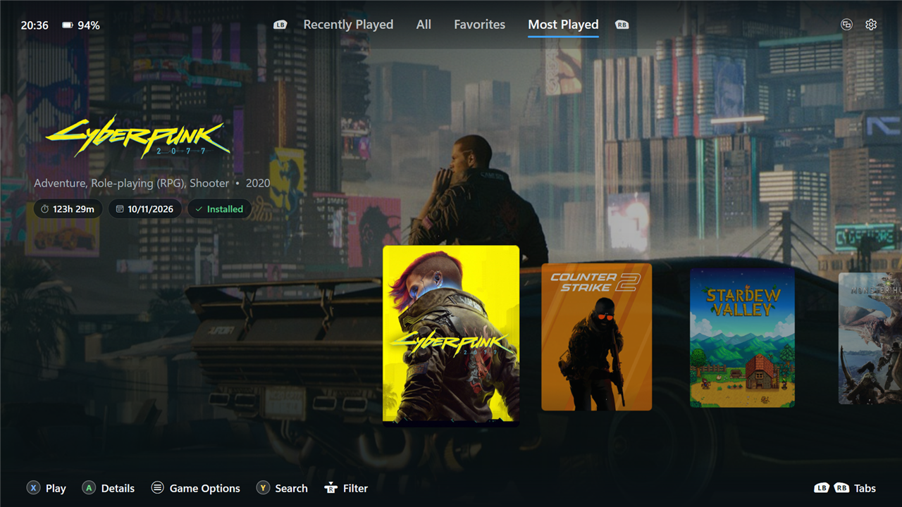
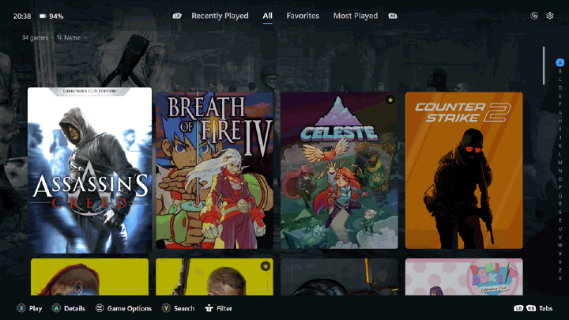
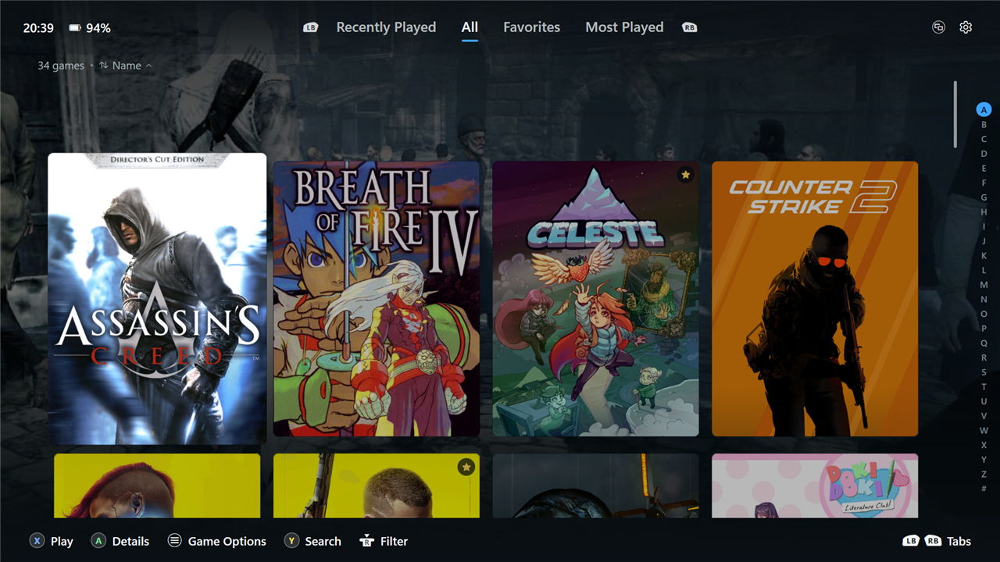
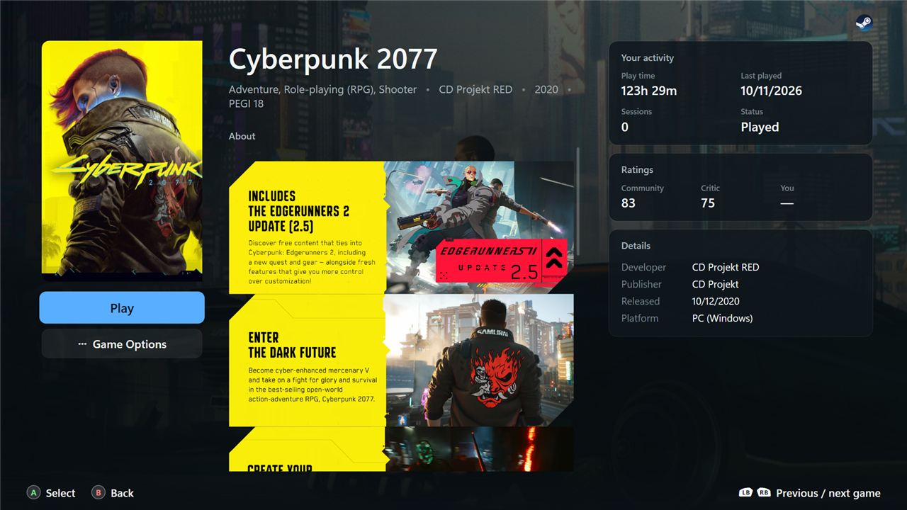
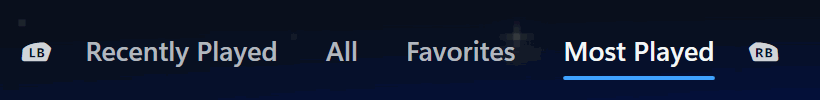

# Calm Hero

A calm, gamepad-first **Fullscreen theme for [Playnite](https://playnite.link)**, built for Windows handhelds
(ROG Ally, Legion Go, Steam Deck on Windows, MSI Claw). Forked from
[Handheld Hero](https://github.com/nickhighland/HandheldHero) by nickhighland.

## Previews

| | |
|---|---|
|  |  |
| The carousel row slides to the next game while the background crossfades. | The filter panel slides in from the left. |
|  |  |
| Library grid with the letter jump bar. | Details page, with Your activity, Ratings and Details on the right. |

When you press LB or RB, the accent underline moves over to the new tab:

## Install

### From a release file (.pthm)

1. Download `CalmHero.pthm` from the [Releases](https://github.com/azhimn/calm-hero/releases) page.
2. Double-click the file, or drag it onto the Playnite window. Playnite asks whether to install the theme.
3. Restart Playnite when it asks.

### Manual install

1. Download this repo (**Code > Download ZIP**) and unzip it.
2. Copy the `HandheldHero` folder into `%APPDATA%\Playnite\Themes\Fullscreen\` and rename it to
   `CalmHero_a1af5af7-dcb8-4ffe-9f19-19ba154b7b46`.
3. Restart Playnite.

### From the Playnite add-on browser

Coming soon.

### Select the theme

In Fullscreen mode, open the menu (View / Select button), go to **Settings > Visuals** and pick **Calm Hero** in the
**Theme** dropdown. Leave the menu and restart Playnite when it asks.

### Optional extensions

The theme works without these. Both are in Playnite's add-on browser (in Desktop mode, **Main menu > Add-ons… > Browse > Generic**):

- Theme Options, for the choices listed under [Settings](#settings-optional).
- Extra Metadata Loader, for game logos and the Trailer button.

## What changed from Handheld Hero

- **Typography and icons:** Segoe UI Variable and Segoe Fluent Icons (both ship with Windows 11; Windows 10 falls back to
  Segoe UI and Segoe MDL2 Assets). No more mixed symbol fonts.
- **Top bar:** clock and battery on the left, plain tabs with an accent underline that hands over between tabs,
  LB / RB hints next to the tabs, settings button with its View-button hint on the right.
- **No repeated page titles.** Grid pages show a quiet "N games · sort order" line instead.
- **Carousel:** the row slides to the next game; no PLAY / INFO buttons, reflection or glow on the cover (the bottom bar has the actions).
- **Selection:** "Lift" by default. The focused cover grows and the others dim, with no animated border.
- **Details page:** Your activity moved to the right column next to Ratings and Details; readable Play / Game options / Trailer buttons.
- **Overlays:** main menu, settings, filter panel, game menu, dialogs and the on-screen keyboard are rounded
  panels on one solid surface, with toggle switches, chevron rows and a short slide-in.
- **Button prompts:** mono discs (dark disc, coloured letter) by default.
- Still no pixel-shader effects anywhere, so it stays smooth on handheld iGPUs.

## Settings (optional)

Install the [Theme Options](https://playnite.link/addons.html#ThemeOptions_904cbf3b-573f-48f8-9642-0a09d05c64ef)
extension to change, in **Settings > Theme Options**:

| Option | Choices (default first) |
|---|---|
| Font | Segoe UI Variable, Bahnschrift, Segoe UI |
| Selection style | Lift, Ring, Thin accent ring |
| Tab style | Underline, Soft pill, Text only |
| Button prompts | Mono, Colour |
| Carousel movement | Animated slide, Instant |
| Reopen the last used tab | Off (start on the first tab), On |

**Tab order and names** come from Playnite itself: tabs are your filter presets, and their order is set in Playnite (Desktop mode filter presets). The first tab is where the theme starts.

Clock, battery and battery percentage follow Playnite's own Fullscreen settings.

## Tabs and layout

The layout is chosen by the **name of the filter preset** shown as a tab. These names get the centered carousel:
`HOME`, `FAVORITES`, `RECENT`, `RECENTLY PLAYED`, `RECENTLY ADDED`, `RECENT GAMES`, `MOST PLAYED`, `TOP PLAYED`,
`CONTINUE PLAYING` (case-insensitive). Any other tab (for example `ALL`) uses the library grid.

## Optional plugins

- [Extra Metadata Loader](https://github.com/darklinkpower/PlayniteExtraMetadataLoader): game logos and the Trailer button.
- [SuccessStory](https://github.com/Lacro59/playnite-successstory-plugin): achievements on the details screen.

## Development

The theme files live in `HandheldHero/`. `design/mockup/` holds the HTML mockup used to agree on the design
(its fonts and art are git-ignored), `tools/` the test helpers. Tested with Playnite 10.x (theme API 2.9.0).

## License

MIT. Based on Handheld Hero (MIT, nickhighland), which derives from Playnite's default Fullscreen theme (MIT, Josef Nemec).
